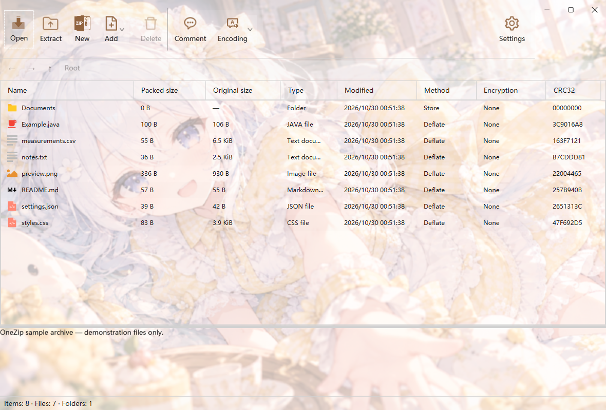
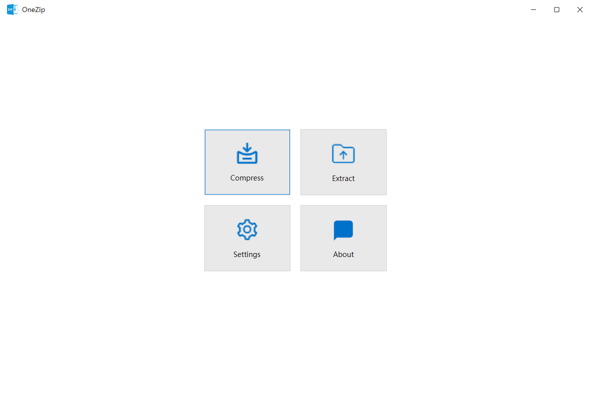
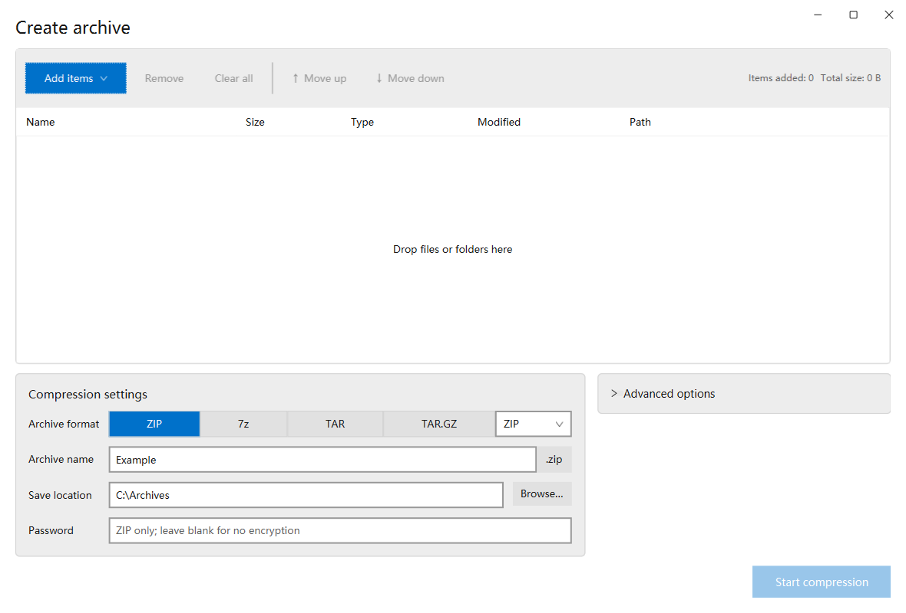

# OneZip

[English](README.md) · [简体中文](README.zh-CN.md) · [繁體中文](README.zh-TW.md) · [日本語](README.ja.md)

一个使用 Java 21 与 JavaFX Fluent 的轻巧压缩工具。

感谢 vibe coding，也能让旧软件焕发第二春了。

[**下载最新版本 →**](https://github.com/shed4329/onezip/releases/latest)



<details>
<summary>首页和压缩界面</summary>




</details>

## 功能

- 创建和解压 ZIP、7z、TAR、GZIP、LZ4、XZ、BZIP2 及 TAR 组合格式。
- 打开和解压 RAR4／RAR5。
- ZIP32 文件添加、替换、删除，以及 AES-256 加密创建。
- 多线程、压缩级别、实时速度和进度显示、取消操作。
- 四种界面语言、浅色／深色主题、主题色和自定义图片背景。
- GUI 与 CLI 共用一套程序，压缩编解码器由 Java 自行实现。

## 开始使用

Windows 用户下载 **x64 安装包**或 **x64／x86 便携 ZIP**。便携版自带 Java，完整解压后运行 `OneZip.exe` 即可。

命令行使用 `OneZipCLI.exe`：

```powershell
OneZipCLI.exe c backup.7z documents --threads 4
OneZipCLI.exe x backup.7z -o restored
```

## 从源码运行

安装 JDK 21 后执行：

```powershell
.\mvnw.cmd test package
.\run-onezip.cmd
```

[命令行](docs/CLI.md) · [设置](docs/SETTINGS.md) · [格式与限制](docs/JAVA-ENGINE.md) · [开发](docs/DEVELOPMENT.md)

## 许可证

[Apache-2.0](LICENSE)。依赖、图标和运行时授权见[第三方说明](docs/THIRD-PARTY.md)。
